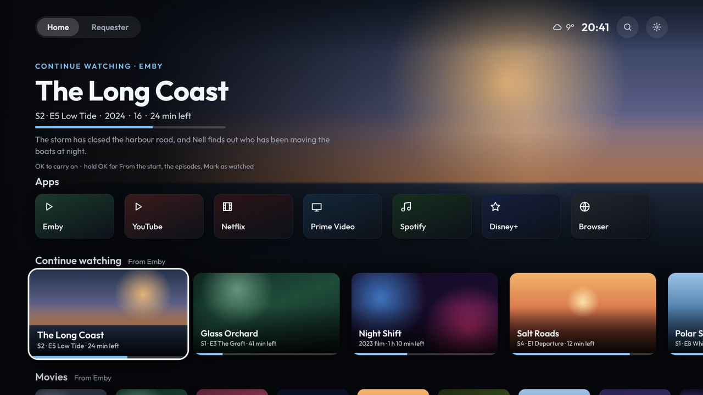

# Shield Launcher

A fast, ad-free home screen for the NVIDIA Shield TV (and other Android TV boxes, Android 8 or newer).



- **Home:**
  - your apps in your order: hold OK on one to move it, take it off the row, or add another
  - Continue watching, Movies and TV shows from Emby; OK plays in the Emby app from where you left off
  - films' trailers play behind the top, muted; hold OK for the trailer with sound
  - games from Artemis
  - SmartTube's rows (and other apps' channels), the same as on the stock launcher
- **Requester:** Seerr's trending, popular and coming-soon films and shows.
  - Request a film, or a show's seasons, from the TV.
  - Your films and shows on Emby, to delete what you're done with (through Radarr and Sonarr).
- **TV:** IPTV from an Xtream provider, played in the launcher.
  - Live channels with what's on now, a guide, films and series (with where you got to).
  - Your own groups of channels, or the provider's imported and kept up to date.
  - A buffer setting for shaky connections, and streams that reconnect by themselves.
- **Set up from your phone:** scan a code on the TV, then arrange rows and apps, and sign in to Emby, Seerr and IPTV, and build your channel groups, with the phone's keyboard.
- **Home Assistant notifications** over whatever is playing. They work with Home Assistant's own *Notifications for Android TV / Fire TV* integration, on port 7676.
- **Updates from GitHub:** a note on Home when there's a new version. One press downloads and installs it, then deletes the download.

**[The wiki](https://github.com/bornaradusin/ShieldLauncher/wiki)** has everything: installing, every screen, and troubleshooting.

## Installing (short version)

Android TV doesn't let you choose a home screen, so the stock one is switched off once from a computer, with network debugging turned on in the Shield's Developer options:

```
adb connect <shield-ip>
adb install ShieldLauncher-1.1.1.apk
adb shell appops set io.github.bornaradusin.launcher SYSTEM_ALERT_WINDOW allow
adb shell pm grant io.github.bornaradusin.launcher com.android.providers.tv.permission.READ_EPG_DATA
adb shell pm disable-user --user 0 com.google.android.tvlauncher
```

Then press Home. To undo it: `adb shell pm enable com.google.android.tvlauncher`. The full steps are in [Installing](https://github.com/bornaradusin/ShieldLauncher/wiki/Installing).

## Building

GitHub Actions builds every push. A push to `main` also puts the APK on a draft release for the version in `app/build.gradle.kts`, to check and publish by hand. The APK is signed with the key in `signing/release.jks.enc`, which the repository secret `ANDROID_KEYSTORE_PASSWORD` opens.

The wiki is edited in `wiki/` on `main`. A push that changes it copies it to the GitHub wiki (`.github/workflows/wiki.yml`).
