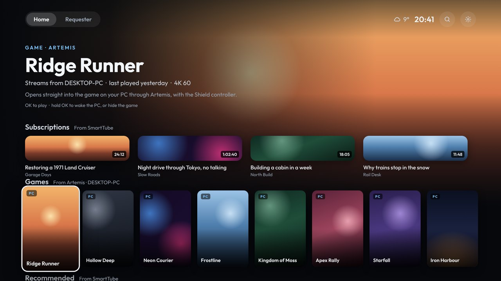

# SmartTube and app channels

Apps can share rows with the TV's home screen. Android calls these *channels*, and they're what the stock launcher shows as SmartTube's rows, Netflix's and so on. Shield Launcher shows them as rows too.



## Getting them

1. **Allow the launcher to read TV listings.** The TV asks the first time the launcher opens. If you said no, use Settings › App channels, or this command from a computer:
   ```
   adb shell pm grant io.github.bornaradusin.launcher com.android.providers.tv.permission.READ_EPG_DATA
   ```
2. **Make sure SmartTube shares its rows.** In SmartTube's own settings, turn on its home screen channels if they're off.
3. **Turn the rows on.** They show up in **Settings › Rows on Home**, and on the phone page.
   - SmartTube's rows start switched on.
   - Other apps' rows (Netflix, Prime Video…) start switched off.

## Using them

- **OK:** opens the video in its app, the same as on the stock launcher.
- **Pictures:** wide ones for videos, posters when the app gives tall ones.
- **Updates:** the rows change as the app changes them. It's checked again every few minutes, and whenever Home comes back.
