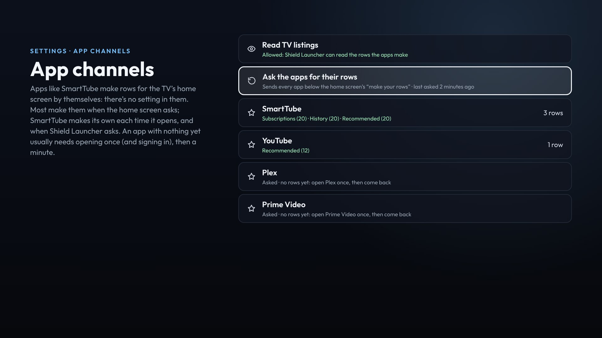

# SmartTube and app channels

Apps can share rows with the TV's home screen. Android calls these *channels*, and they're what the stock launcher shows as SmartTube's rows, Netflix's and so on. Shield Launcher shows them as rows too.


## Getting them

It's automatic: SmartTube (and the other apps) have no setting for it.

1. **Allow the launcher to read TV listings.** The TV asks the first time the launcher opens, and once more after updating to 1.4.5: versions before it asked for a permission Android no longer checks, so other apps' rows stayed hidden. If you said no, use **Settings › Home › App channels**, or this command from a computer:
   ```
   adb shell pm grant io.github.bornaradusin.launcher android.permission.READ_TV_LISTINGS
   ```
2. **The apps make their rows when the home screen asks.** The stock home screen asks each app once it's installed, so with it switched off, nobody did. Shield Launcher now asks them itself:
   - once for each app, and again after it's updated;
   - when an app is installed;
   - when you allow reading TV listings.

   SmartTube doesn't wait to be asked: it makes its rows each time it opens, and Shield Launcher sets that off too. It only makes them while Android TV's own home screen is on the Shield (switched off, as in [Installing](Installing), is fine; removed isn't). Both SmartTube's current app and the old one from before its new signing key (November 2025) are recognised.
3. **Turn the rows on.** They show up in **Settings › Home › Rows on Home**, and on the phone page.
   - SmartTube's rows start switched on.
   - Other apps' rows (Netflix, Prime Video…) start switched off.

## Settings › App channels



This page shows what's going on:

- **Read TV listings:** whether the launcher may read the rows. OK asks for it.
- **Ask the apps for their rows:** sends every app the home screen's "make your rows" again, and says when they were last asked.
- **Each app that makes rows,** with the rows it has made and how many videos are on each. An app with none yet says so; OK opens it.

If an app has no rows after being asked, open it once (and sign in, for SmartTube), then give it a minute. Some apps only make their rows after they've been used.

## Using them

- **OK:** opens the video in its app, the same as on the stock launcher.
- **Pictures:** wide ones for videos, posters when the app gives tall ones.
- **Updates:** the rows change as the app changes them. It's checked again every few minutes, and whenever Home comes back.
