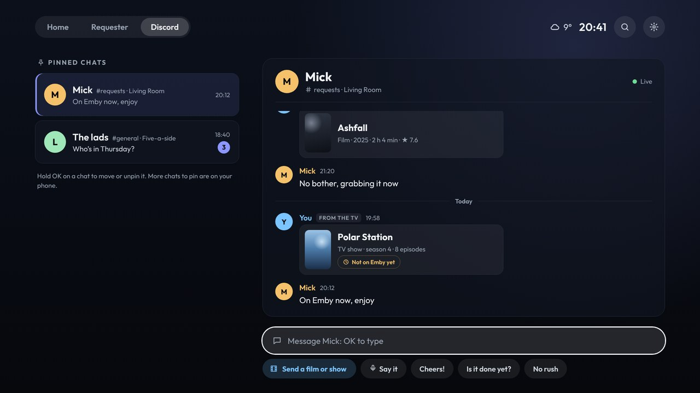
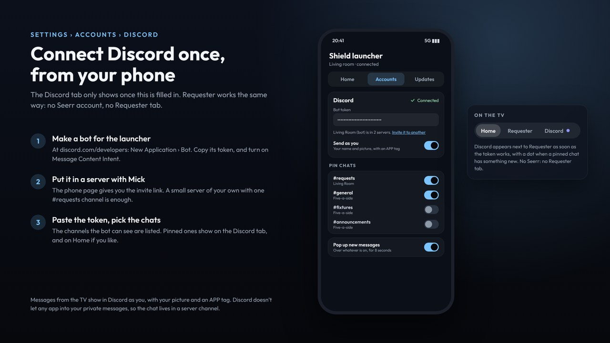
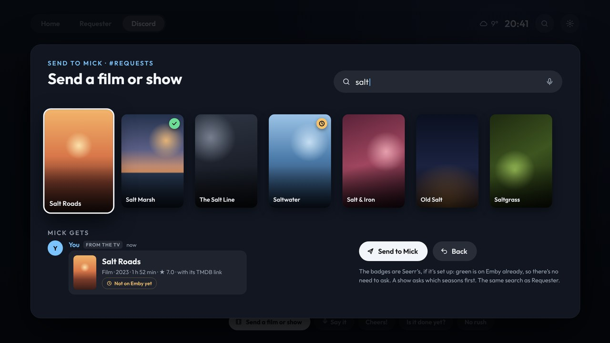
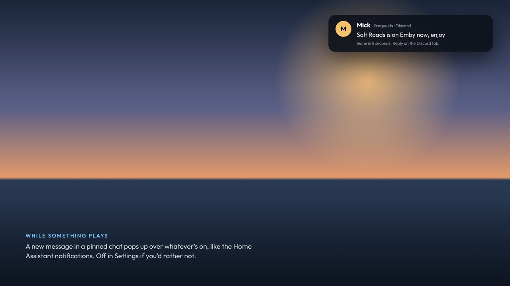

# Discord

The Discord tab keeps the chats you use most one press away: pin a chat (the one where you ask someone to get a film, say), read it on the TV, and send a film or show in a couple of presses.

The tab only shows once Discord is connected. (Requester works the same way: no Seerr, no Requester tab.)

## Connecting

Discord only lets apps in as a **bot**, so the launcher gets a bot of its own. Logging in as yourself from another app is against Discord's rules, and Discord bans accounts for it.

1. On [discord.com/developers](https://discord.com/developers/applications), press **New Application** and give it a name (that's the bot's name). Then open **Bot**.
2. On the Bot page, turn on **Message Content Intent**. Without it the bot can't read what the messages say.
3. Press **Reset Token** and copy the token.
4. Open **Set up from your phone** (Settings on the TV shows the code). On **Accounts › Discord**, paste the token and press **Connect**.
5. Press **Invite the bot to a server** and pick the server where you and the other person chat. The link gives the bot what it needs there: see and read channels, send messages and links, and manage webhooks.
6. The server's channels show up under **Pinned chats**. Switch on the ones you want on the TV.

A bot can't read private messages between two people (no app can), so the chat has to be in a server channel. A small server of your own with one channel, `#requests` say, and the other person invited is enough.

## Who the messages are from

**Messages from the TV show as** (on the phone page) picks who your messages are from:

- **You:** your name and picture, with Discord's small APP tag. The launcher picks the owner of the first pinned chat's server to begin with, which is usually you. This needs the bot to be allowed to **Manage Webhooks** in the channel. The invite link allows that; if it's been taken away, the TV says so under the chat and sends as the bot until it's back.
- **The bot:** the bot's name and picture.

On the TV, your messages have a small **FROM THE TV** tag.

## The tab

- **On the left:** the pinned chats, with the last message and how many are new. OK opens one. Hold OK to move it up or down, or unpin it.
- **On the right:** the open chat. A chat with one other person in it is called by their name; otherwise by the channel's. Go up into the messages and press ▲ to read back, ▼ to come forward again.
- **The box:** OK opens Android's keyboard (its mic key works too). The keyboard's Send key sends the message; Back keeps what you wrote in the box for later.
- **Say it:** Android's voice typing. What you say goes in the box, and **Send** sends it.
- **Cheers!**, **Is it done yet?** and **No rush** send straight away.
- **Live** at the top right means messages arrive the moment they're sent. **Connecting to Discord…** means the line is down for a moment (the launcher gets back on its own, and catches up on what it missed).

A dot on the Discord tab means a pinned chat has something new.

## Send a film or show

Needs Seerr connected (see [Requester](Requester)).

1. Press **Send a film or show**. Seerr's search comes up, the same as Requester's.
2. Type a name (or use the keyboard's mic). The badges are Seerr's: green means it's on Emby already, so there's no need to ask for it.
3. OK on one. For a show, pick the seasons (the ones not on Emby yet are picked to begin with; none picked means the whole show).
4. **Send** sends its name, year, seasons and its TMDB link. Discord shows the link with the poster.

## Pop-ups

A new message in a pinned chat pops up over whatever is on, for 8 seconds, with the person's picture (and the picture or poster that came with it). It doesn't pop up for the chat you have open on the TV, or for your own messages.

To turn pop-ups off: **Settings › Accounts › Discord pop-ups** on the TV, or **Pop up new messages** on the phone page.

## If something's wrong

- **"Turn on Message Content Intent"**: step 2 above, then the launcher reconnects on its own.
- **"Discord doesn't accept the bot's token any more"**: the token was reset. Copy the new one and press **Connect** again on the phone page. The pinned chats stay.
- **"The bot can't read this channel"**: in Discord, the channel's permissions keep the bot out. Let it View Channel and Read Message History there.
- **No channels on the phone page**: the bot isn't in a server yet. Use **Invite the bot to a server**.
