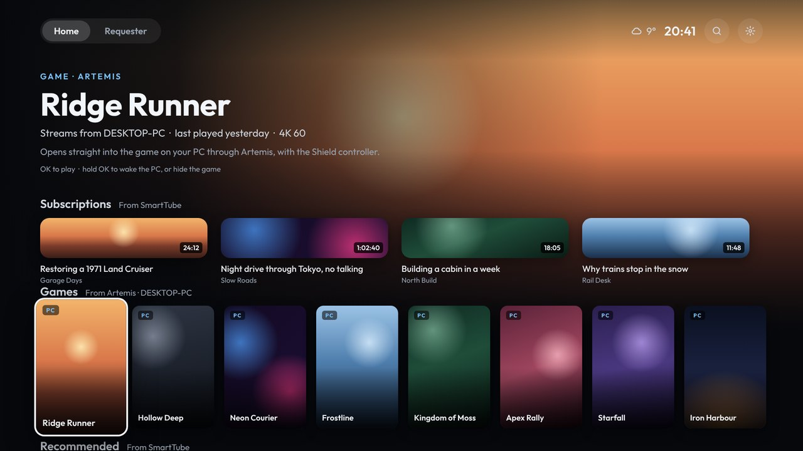

# Games

Games come from **Artemis** (Moonlight for Sunshine/Apollo hosts).

## Adding one

1. Open Artemis and go to your PC's games.
2. Hold OK on a game and choose **Create shortcut**.
3. Android hands it to the home screen, and it shows up in **Games** with its box art.

Only the Shield's home screen can take these, so Shield Launcher has to be the home screen ([Installing](Installing)).

## Using them

- **OK:** opens Artemis straight into the game on your PC.
- **Hold OK:** Play, or Remove from Games.

Games can also be removed from the phone page (Accounts › Games).
