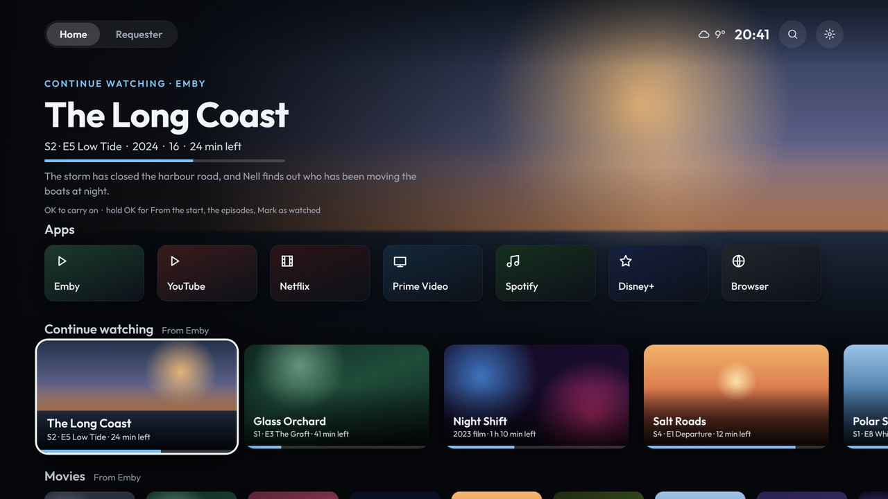
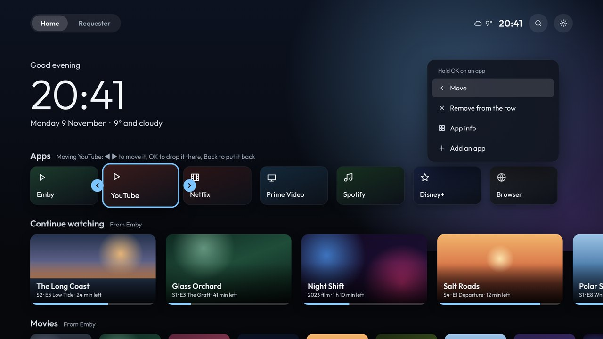
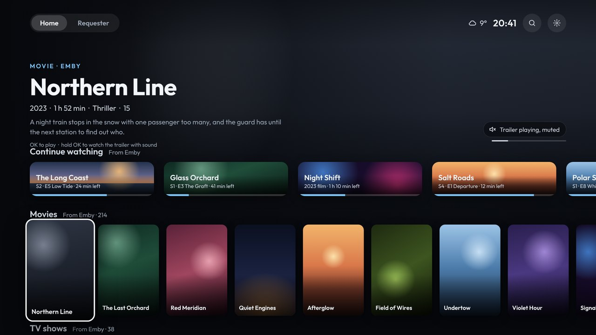
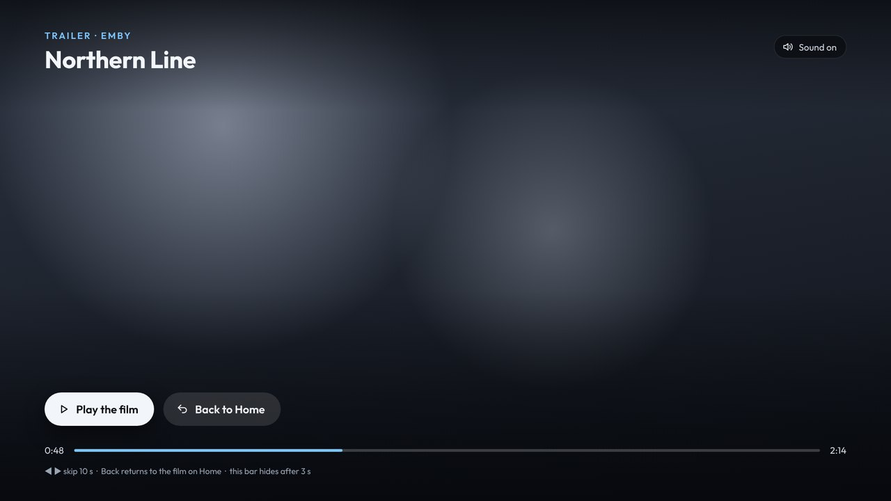

# Home screen

## The top

- **Tabs:** at the top left. Press OK on one to switch. **Requester** shows once Seerr is connected, and **[Discord](Discord)** once Discord is (with a dot when a pinned chat has something new).
- **On the right:** the weather and the time, then **Search** (the Shield's own Google search) and **Settings**.
- **Update:** when there's a new version, an Update button appears here too.
- **The big area:** shows the focused card: the film's picture and details, an episode's progress, or a game.
  - On the apps row it shows a fun fact (a new one every hour), a big clock (classic, flip or minimal: see [Seasons and the sky](Seasons-and-sky#clock-styles)) and the date, with the weather beside them: now, and the next 5 days (highest, lowest and the chance of rain). The small time and weather in the top bar hide while it does, so there's only one clock. The forecast always starts after the time, however wide the time is (12 or 24 hour), and only fades in once the words about a film or show have gone.
  - Behind the apps row, the colours come from the weather and the time of day, and the weather outside moves over the whole screen: rain (with drops on the glass in front of everything), snow, lightning, clouds, fog, the night sky, the sun, and sunrise and sunset. [Weather](Weather#what-each-weather-looks-like) shows each one moving. The time of year, ice when it's freezing, fog on the glass and the sky's events show there too: see [Seasons and the sky](Seasons-and-sky).
  - A weather warning for your area shows as a coloured line above the forecast. See [Weather](Weather).

## The rows

Each row can be turned on or off and moved, in **Settings › Home › Rows on Home** or from your phone.

| Row | What it is | OK | Hold OK |
|---|---|---|---|
| **Apps** | Your apps, in your order | Opens the app | Move, Remove from the row, App info, Add an app |
| **Continue watching** | Started films and episodes on Emby, then the next episode of shows you're watching | Carries on in the Emby app, from where you left off | From the start, The episodes, Trailer, Mark as watched, Remove from Continue watching |
| **Movies** | Films on Emby, newest first | Plays in the Emby app | The trailer, full screen with sound |
| **TV shows** | Shows on Emby, the one with the newest episode first | Opens the show in Emby | The trailer, full screen with sound |
| **Games** | Games added from Artemis ([Games](Games)) | Starts the game on your PC | Play, Remove from Games |
| **SmartTube's rows**, and other apps' | Subscriptions, Recommended and so on ([App channels](App-channels)) | Opens it in SmartTube | |

### The apps row

- **Hold OK on an app** for its menu:
  - **Move:** ◀ ▶ moves it along the row, OK drops it there, and Back puts it back where it was.
  - **Remove from the row:** takes it off the row. It stays installed.
  - **App info:** opens Android's page for the app.
  - **Add an app:** shows every app that isn't on the row. The new one goes at the end.
- **The first time,** the row fills itself with the usual TV apps you have installed (Emby, SmartTube, Netflix…).

### Trailers

- **Behind the top:** stay on a film or show for 2 seconds and its trailer plays behind the top, muted. Settings › Home › **Trailer sound** plays them with sound instead, and Settings › Home › **Trailers behind films** turns them off.
- **With sound:** hold OK on it for the trailer full screen. Play the film from there, or press Back.
  - ▼ goes down to the progress bar, and ◀ ▶ then skip 10 seconds.
- **Where trailers come from:** Emby. Either a trailer kept on the server with the film, or the trailer link Emby has for it (YouTube). If a YouTube trailer can't play in the launcher, it opens in SmartTube.

## The remote

- **Home:** brings you back to the start of the apps row, from anywhere.
- **Back:** on Home, goes back to the apps row. It never leaves the launcher.

## Fun facts

Above the clock on the apps row there's a fun fact, and a new one each hour that Home is on screen. A fact is never shown twice.

- They come from the list in the launcher's GitHub repo (`app/src/main/assets/facts.txt`, one fact a line). The TV fetches it every day, so facts added there show up without a new version.
- Once every fact on the list has been shown, they come from Wikipedia's "On this day" for the date (wars, disasters and deaths left out), until the list has new ones again.

## Burn-in protection

On by default: every couple of minutes everything on the screen moves over a pixel or two, one pixel at a time, too little to notice, so the clock, the tabs and the rows never sit on exactly the same pixels for hours. That's what wears in a picture on OLED TVs. To turn it off: **Settings › Look › Burn-in protection**, or **Burn-in protection** on the phone page.
