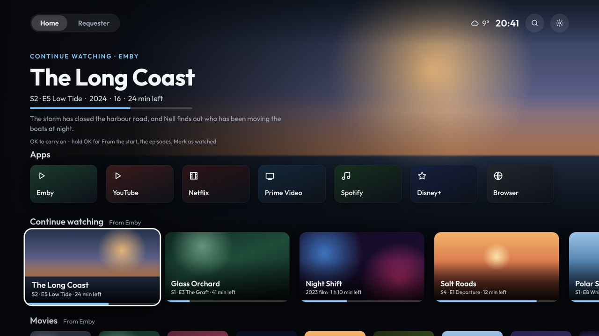

# Shield Launcher

A fast, ad-free home screen for the NVIDIA Shield TV (and other Android TV boxes, Android 8 or newer).

It has two screens, with tabs at the top left:

- **[Home](Home-screen):** your apps, then Continue watching, Movies and TV shows from Emby, games from Artemis, and SmartTube's rows. You choose which rows show, and in what order.
- **[Requester](Requester):** Seerr's trending, popular and coming-soon films and shows. Request them from the TV, and tidy your Emby library by deleting what you're done with.

It also has:

- **[Set up from your phone](Phone-setup):** scan a code on the TV, then arrange things and sign in with your phone's keyboard.
- **[Home Assistant notifications](Home-Assistant)** over whatever is playing. They work with Home Assistant's own *Notifications for Android TV* integration.
- **[Updates](Updates)** from GitHub: a note on Home when there's a new version. One press downloads and installs it, then deletes the download.

## Pages

1. [Installing](Installing): install it and make it the Shield's home screen
2. [Home screen](Home-screen)
3. [Requester](Requester)
4. [Set up from your phone](Phone-setup)
5. [SmartTube and app channels](App-channels)
6. [Games](Games)
7. [Home Assistant notifications](Home-Assistant)
8. [Settings](Settings)
9. [Updates](Updates)
10. [Troubleshooting](Troubleshooting)
