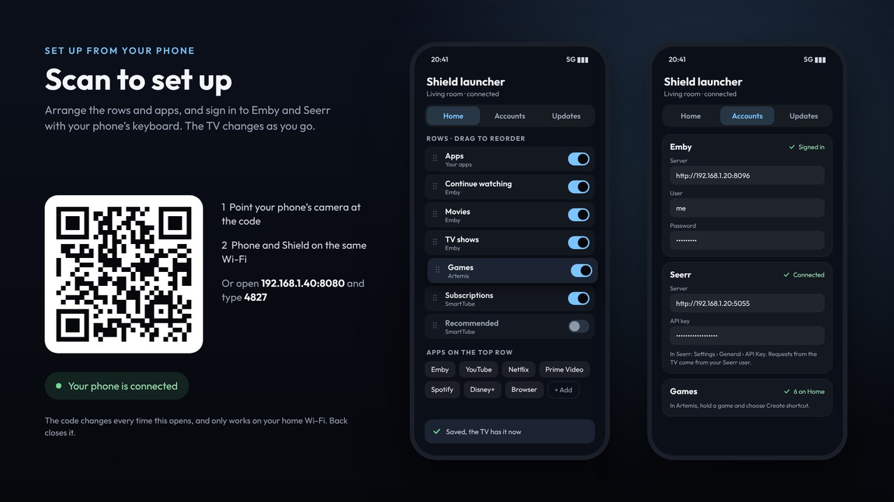

# Set up from your phone

Typing on a TV with a remote is slow, so the launcher has a page for your phone.

## On and off

The phone page is **off** unless you're using it, so nothing on your network can change the launcher.

- **Turning it on:** opening **Set up from your phone** on the TV switches it on.
- **Turning it off:** use **Settings › Phone set-up page**.
- **While it's off,** port 7676 only takes Home Assistant's notifications.

## Connecting

1. On the TV, open **Settings › Set up from your phone**.
2. Point your phone's camera at the code. The phone and the Shield must be on the same Wi-Fi.
3. Or open the address shown on the TV (for example `192.168.1.40:7677`) and type the 4-number code.

The phone stays paired, so you can bookmark the page. The code changes every time the TV screen opens. "… is connected" shows on the TV once a phone has paired.

## What's on it

- **Home**
  - **Rows:** turn each on or off, and drag them into order. SmartTube's rows are here too ([App channels](App-channels)).
  - **Apps on the top row:** drag them into order, remove them, or add one.
  - **Trailers:** whether trailers play behind films.
- **Accounts**
  - **Emby:** the server (for example `192.168.1.20:8096`), user and password. If both Emby apps are installed, you can choose which one plays.
  - **Seerr:** the server (for example `192.168.1.20:5055`) and its API key, which is in Seerr › Settings › General › API Key. Requests go in as that key's user.
  - **Games:** remove games from Home.
- **Updates:** look for a new version, and update the TV. Android asks once on the TV.

Everything you change shows on the TV straight away.
