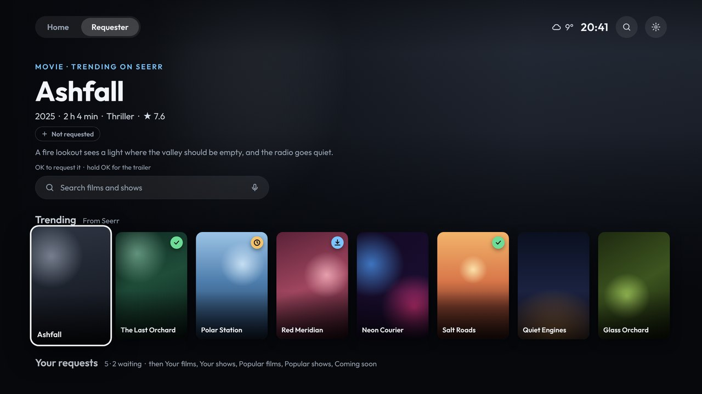
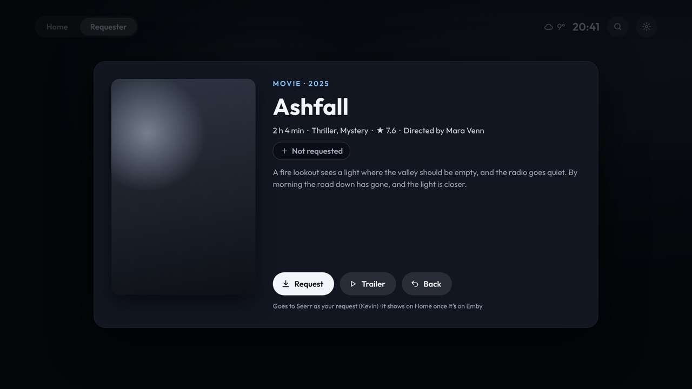
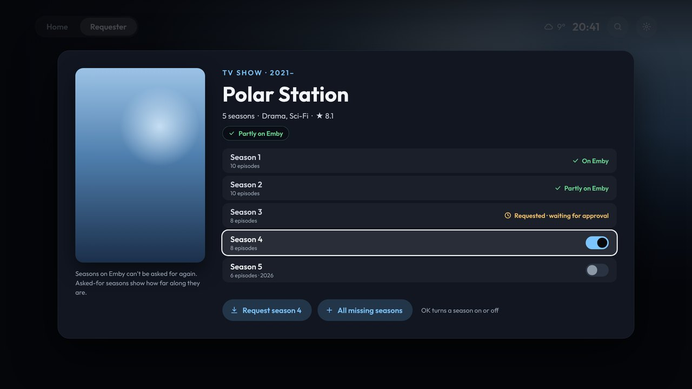
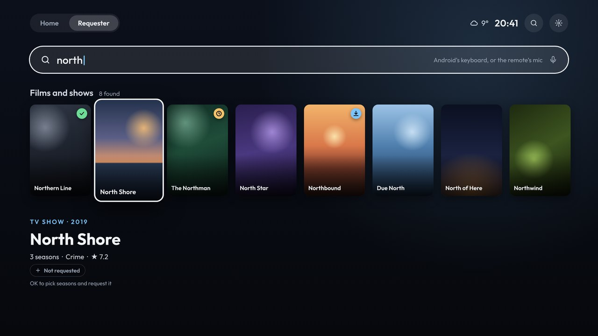
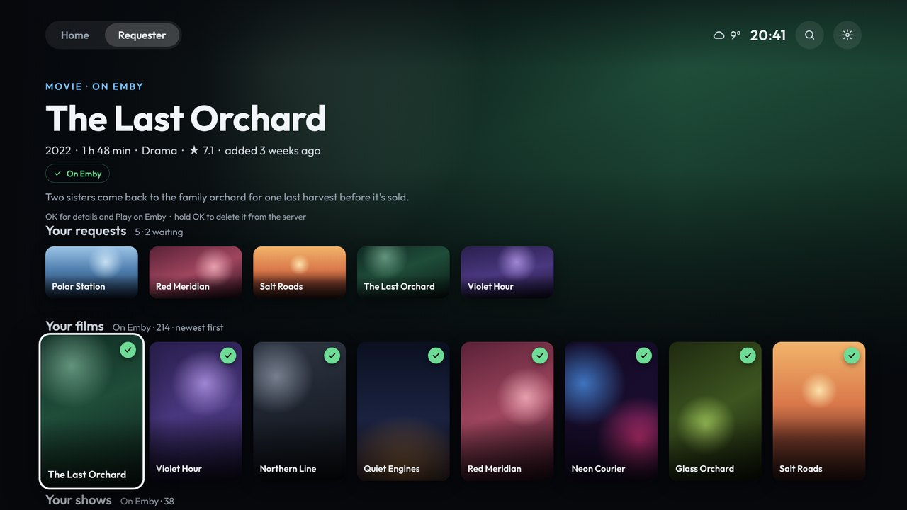
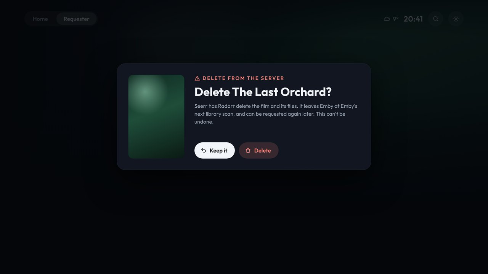

# Requester

Requester is the second tab at the top. It only shows once Seerr is connected: see [Set up from your phone](Phone-setup).

## Rows

| Row | What it is |
|---|---|
| **Search films and shows** | Android's keyboard comes up (its mic key works too), and results show as you type |
| **Trending** | What's trending, from Seerr |
| **Your requests** | What's been asked for, newest first |
| **Your films** | Every film on Emby, newest first |
| **Your shows** | Every show on Emby |
| **Popular films**, **Popular shows** | From Seerr |
| **Coming soon: films**, **Coming soon: shows** | From Seerr |

Every poster has a badge:

| Badge | Means |
|---|---|
| Green ✓ | On Emby (or part of it, for a show) |
| Amber clock | Requested, waiting for approval |
| Blue magnifier | Approved, but not downloading yet: Radarr or Sonarr is still looking for a release |
| Blue ↓ | Downloading now. The details say how far it's got and roughly how long is left |
| Red × | The request was turned down |
| None | Not requested yet |

While Requester is showing, it looks again every minute and a half, so downloads move along.

## Requesting

**OK on a film** opens its details:

- **Request** asks Seerr for it, as the user whose API key the launcher uses.
- **Play on Emby** appears once it's there.
- **Trailer** plays it full screen.

**OK on a show** lists its seasons:

- **Already there:** seasons on Emby, or already asked for, show where they are.
- **The rest:** OK turns each one on or off. Then press **Request … seasons**, or **All missing seasons**.

Once something is on Emby, it shows up on Home too.

## Search

## Tidying your library

**Your films** and **Your shows** list everything on Emby, so you can clear out what you're done with.

- **To delete:** hold OK on a film or show, or press **Delete** in its details. It asks first, with **Keep it** selected.
- **What it does:** Seerr has Radarr (films) or Sonarr (shows) delete it and its files from the server, then forgets it, so you can request it again later. The launcher asks Emby to look over its library, so it disappears from Emby at the next scan.
- **It can't be undone.**
- **Seerr has to know the title.** If it says it doesn't, run Seerr's Emby library scan.

## Holding OK

| On | Hold OK |
|---|---|
| A title that's on Emby | Delete it from the server (it asks first) |
| Anything else | Its trailer |
