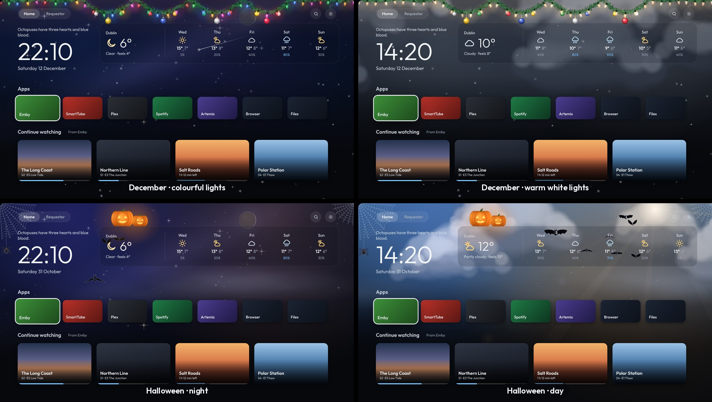
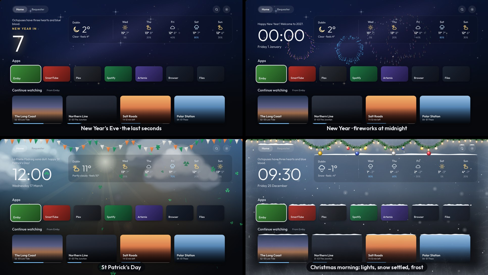
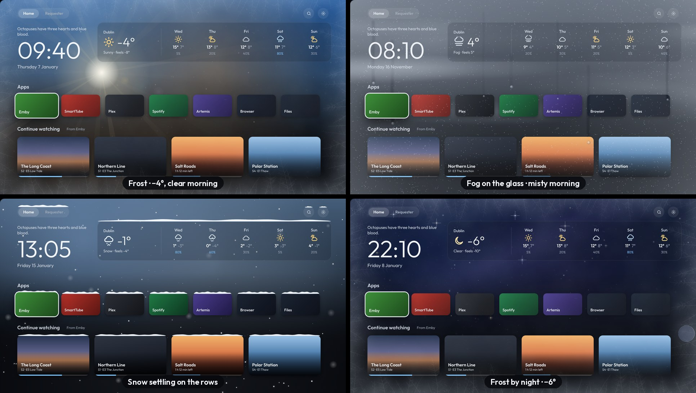
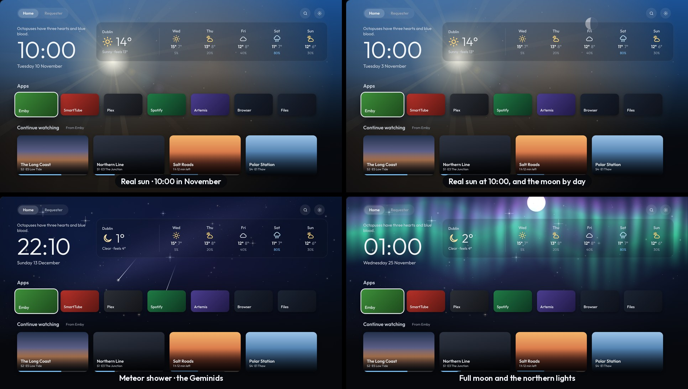
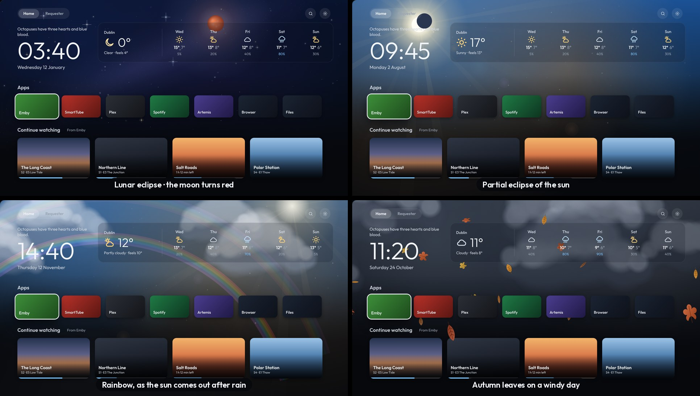
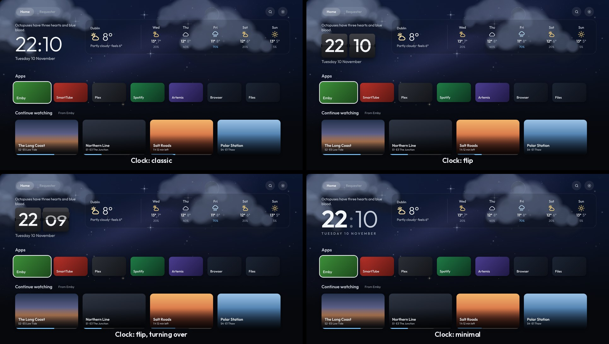

# Seasons and the sky

Behind the apps row, Home follows the time of year, the weather on the glass and what's really happening in the sky. Each of these has a switch in **Settings** (and on the [phone page](Phone-setup)), and is on to begin with.

To see any of them now, whatever the date or the weather: **Settings › Look › Try a look**, then go back to Home and the apps row. OK in Settings steps to the next look. It goes back to off when the launcher restarts.

## Seasonal touches

- **December (1 December to 6 January):** a pine garland across the top with fairy lights woven in. Each bulb twinkles at its own pace, and every so often a wave of light runs along the string. Baubles hang from it and swing in the wind, the lights glow down onto the screen, and gentle snow falls when it isn't already raining or snowing. **Settings › Look › Fairy lights** switches between colourful and warm white.
- **Halloween (24 to 31 October):** cobwebs in the top corners, a spider letting itself down on its thread and climbing back up, jack-o'-lanterns flickering on the weather panel, bats flitting across now and then (some swooping past close up), mist drifting low, and an orange and violet cast over the sky.
- **St Patrick's Day (17 March):** green, white and orange bunting across the top, shamrocks drifting down, a green and gold glow, and a greeting in place of the fun fact.
- **New Year's Eve:** in the last minute of the year the clock counts down (the last ten seconds big and glowing). At midnight, fireworks burst behind the rows for a quarter of an hour, and the fun fact wishes you a happy New Year for the first hour.

The lights, bunting and baubles sway more on windy days (the real wind, from the forecast). Everything combines: Christmas lights over settled snow and frost, for example.

## Glass effects

- **Frost:** at 0° or below, the glass frosts over: a thin mottled film across all of it, ice creeping in along every edge with fine feathers growing from it, and small crystals scattered over the glass. The colder it is, the further in it creeps and the thicker it gets.
- **Fog on the glass:** on foggy mornings, or very damp ones, the glass mists over (thickest at the edges) with a few clear runs where drops slid down.
- **Snow settling:** after snow, a lumpy white layer sits on top of the tabs, the buttons, the weather panel and every card, until it warms up.

## Sky events

- **The real sun and moon:** they sit where they really are in your sky for the time of day, looking south (east on the left, west on the right): low in winter, high in summer. The sun rises on the left and sets on the right. The moon shows only when it's up, by day too (pale, in its phase).
- **Meteor showers:** on the nights of the big showers (the Quadrantids, Lyrids, Eta Aquariids, Perseids, Orionids, Leonids and Geminids), shooting stars come thick and fast, all flying out from the one point in the sky.
- **Full moon:** bigger and brighter, with the sky lit around it.
- **Eclipses:** in a total eclipse of the moon it turns copper red (if it's up where you are). In a partial eclipse of the sun seen from Ireland, the moon takes a bite out of the sun.
- **Northern lights:** green curtains with pink tops ripple across the night when NOAA's live aurora reading says they could be seen from Ireland (and the sky is clear).
- **Rainbow:** when the sun comes out right after rain, opposite the sun.
- **Autumn leaves:** on windy days from mid-September to November, leaves blow across the screen (one or two close up).

## Clock styles

**Settings › Look › Clock style** (or the phone page): **Classic** (as it always was), **Flip** (KitKat-era HTC style: the cards turn over as the minutes change) or **Minimal** (bold hours, light minutes, the date spaced out underneath).
