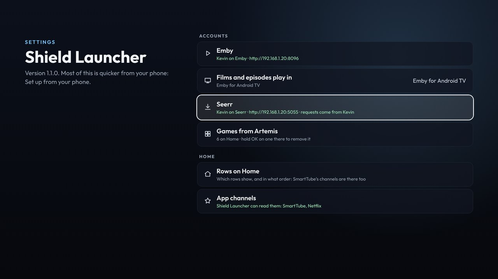
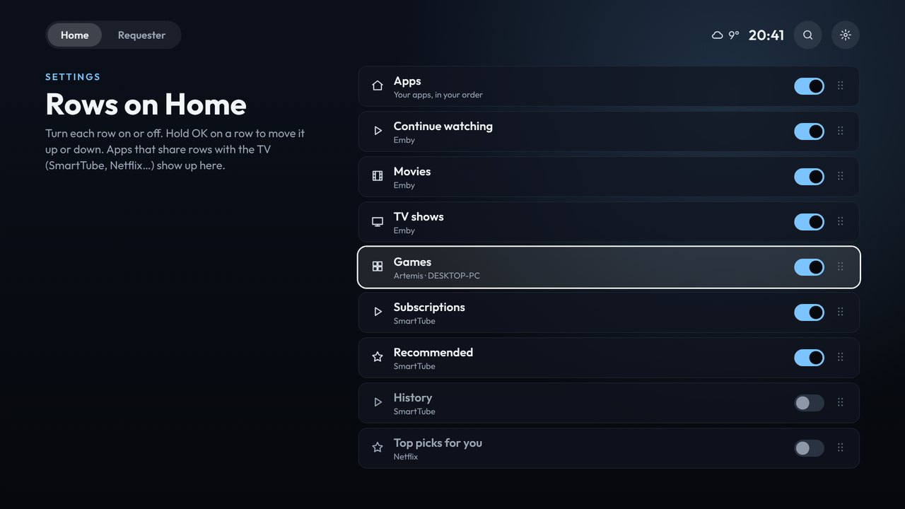

# Settings

Open it with the cog at the top right. Back goes back a page, and from the first page, back to Home.

## Home

- **Rows on Home:** OK turns a row on or off. Hold OK to pick a row up, ▲ ▼ to move it, then OK to drop it (Back puts it back).

  

- **Phone set-up page:** on or off. Off when you're not using it, so nothing on the network can change the launcher. Set up from your phone switches it on.
- **Set up from your phone:** the code to scan ([Set up from your phone](Phone-setup)).
- **Trailers behind films:** the trailers that play behind a film on Home, on or off.
- **Trailer sound:** whether those trailers play with sound. Off (muted) to begin with. Holding OK on a film always plays its trailer full screen with sound.
- **App channels:** whether the launcher may read SmartTube's rows (and other apps'), and which apps have them ([App channels](App-channels)).

## Accounts

- **Emby:** who's signed in, and where. OK fetches the rows again.
- **Films and episodes play in:** Emby for Android TV, or Emby. OK switches, if both are installed.
- **Seerr:** who's connected, and where. OK fetches Requester's rows again.
- **Discord:** the bot, how many chats are pinned and who the TV's messages are from. OK fetches the chats again. See [Discord](Discord).
- **Discord pop-ups:** new messages in pinned chats over whatever is on, on or off.
- **Games from Artemis:** how many games are on Home.

## Home Assistant

- **Weather for:** the town the weather is for. It's changed from your phone ([Weather](Weather)).
- **Weather warnings:** pop-ups for new warnings, on or off.
- **Notifications on the TV:** whether the launcher can show them over other apps, the address Home Assistant uses, and when the last notification came in and whether it showed ([Home Assistant notifications](Home-Assistant)).
- **Send a test notification**

## The Shield

- **Home button:** whether Home opens Shield Launcher, and the steps to make it ([Installing](Installing)).
- **Updates:** the version you have. OK looks for a new one, or installs one that's ready ([Updates](Updates)).
- **Android settings:** the Shield's own settings (network, display, sound, remotes).
