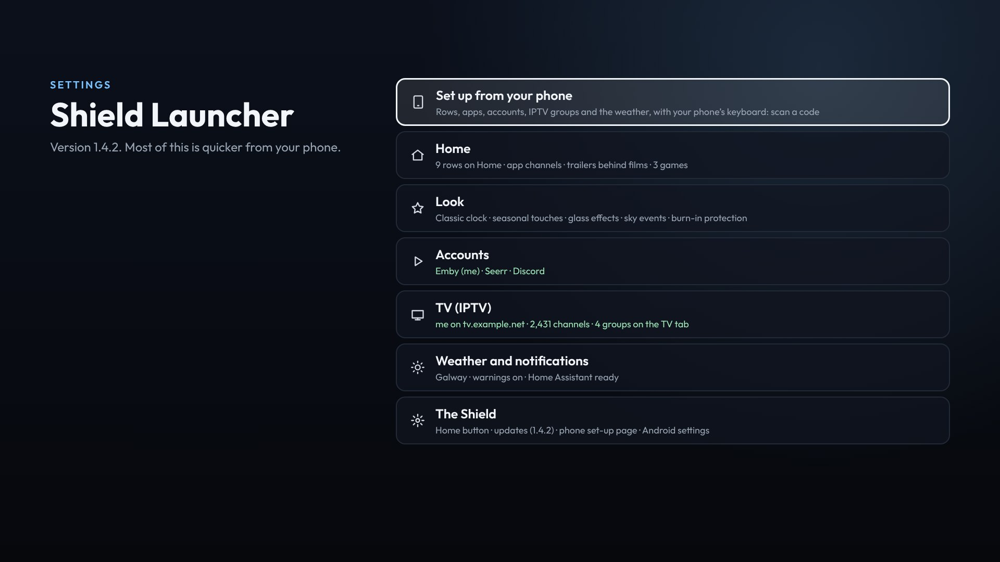

# Settings

Open Settings with the cog at the top right. The first page is a short list: **Set up from your phone**, then one line per category. Each category line shows how it stands, and OK opens its own page.

**Back** goes back a page. From the first page, it goes back to Home.

A line too long to fit scrolls by while it's focused. The Home button steps show in full.

- **Set up from your phone:** the code to scan ([Set up from your phone](Phone-setup)).
- **Home:** rows, app channels, trailers and games.
- **Look:** the clock, the seasons, the sky and the glass.
- **Accounts:** Emby, Seerr and Discord.
- **TV (IPTV):** the TV tab's provider, your groups, films and series, and the buffer. See [TV (IPTV)](TV#settings--tv-iptv).
- **Weather and notifications:** the weather, its warnings, and Home Assistant's notifications.
- **The Shield:** the Home button, updates, the phone set-up page and Android's own settings.

## Home

- **Rows on Home:** OK turns a row on or off. Hold OK to pick a row up, ▲ ▼ to move it, then OK to drop it (Back puts it back).

  

- **App channels:** whether the launcher may read SmartTube's rows (and other apps'). OK opens a page with each app that makes rows, what it has made, and **Ask the apps for their rows** ([App channels](App-channels)).
- **Trailers behind films:** the trailers that play behind a film on Home, on or off.
- **Trailer sound:** whether those trailers play with sound. Off (muted) to begin with. Holding OK on a film always plays its trailer full screen with sound.
- **Games from Artemis:** how many games are on Home.

## Look

- **Clock style:** the big clock on the apps row: Classic, Flip (KitKat-era HTC style) or Minimal. OK switches.
- **Seasonal touches:** December's lights, Halloween, St Patrick's Day and New Year's Eve, on or off. See [Seasons and the sky](Seasons-and-sky).
- **Fairy lights:** switches December's lights between colourful and warm white.
- **Glass effects:** ice when it's freezing, fog on the glass and settled snow when the weather brings them, on or off.
- **Sky events:** the real sun and moon, meteor showers, eclipses, the northern lights, rainbows and autumn leaves, on or off.
- **Try a look:** shows one of the looks now, whatever the date or the weather. OK shows the next; it's off again when the launcher restarts.
- **Burn-in protection:** on by default. Everything moves over a pixel or two every couple of minutes, so nothing sits still on an OLED screen.

## Accounts

- **Emby:** who's signed in, and where. OK fetches the rows again.
- **Films and episodes play in:** which Emby app films and episodes open in. OK switches. This line only shows when both Emby apps are on the Shield (Emby for Android TV and the plain Emby app). With just one installed, films always open in that one.
- **Seerr:** who's connected, and where. OK fetches Requester's rows again.
- **Discord:** the bot, how many chats are pinned and who the TV's messages are from. OK fetches the chats again. See [Discord](Discord).
- **Discord pop-ups:** new messages in pinned chats over whatever is on, on or off.

## Weather and notifications

- **Weather for:** the town the weather is for. Change it from your phone ([Weather](Weather)).
- **Weather warnings:** pop-ups for new warnings, on or off.
- **Notifications on the TV:** shows:
  - whether the launcher can show notifications over other apps;
  - the address Home Assistant uses;
  - when the last notification came in, and whether it showed.

  See [Home Assistant notifications](Home-Assistant).
- **Send a test notification**

## The Shield

- **Home button:** whether Home opens Shield Launcher, and the steps to make it ([Installing](Installing)).
- **Updates:** the version you have. OK looks for a new one, or installs one that's ready ([Updates](Updates)).
- **Set up from your phone:** the code to scan.
- **Phone set-up page:** on or off. Keep it off when you're not using it, so nothing on the network can change the launcher. **Set up from your phone** switches it on.
- **Android settings:** the Shield's own settings (network, display, sound, remotes).
