# TV (IPTV)

The TV tab is IPTV from an Xtream provider, played in the launcher: live channels with what's on now, a guide, films and series. You build your own groups of channels, or import the provider's.

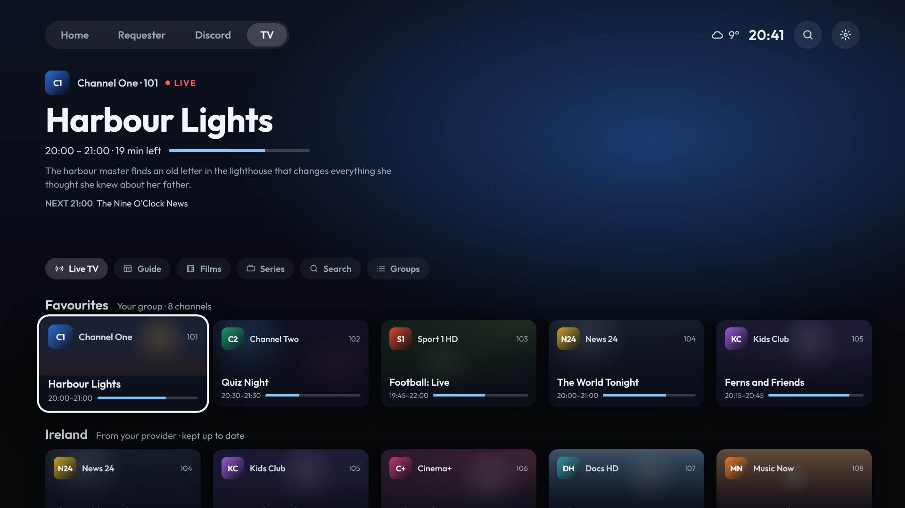

The tab only shows once an IPTV account is connected. Shield Launcher has no channels, subscriptions or playlists of its own: use a provider you're entitled to.

## Connecting

From your phone (quickest): **Set up from your phone › Accounts › IPTV (Xtream)**. Enter the server, username and password, then press **Save and connect**.

On the TV: **Settings › TV (IPTV) › Connect your provider** asks for the same three, one after the other.

- **Server:** the address your provider gave you, for example `http://tv.example.net:8080`. Without `http://`, it's added. A pasted link with `/player_api.php` or `/get.php…` on the end works too.
- The account is checked before it's saved: a wrong password, or a subscription that has run out, says so.
- **Settings › TV (IPTV)** shows who's connected, until when the subscription runs, and how many screens are in use.

## How it loads

- **Channels:** loaded a group at a time, and each group shows as soon as it arrives.
  - If a group fails to load, the channels it had before stay.
  - A slow transfer is never cut off; only one that stops altogether is.
  - Everything is kept on the Shield, so the tab opens at once next time.
  - Channels are fetched again twice a day, or with **Refresh channels and guide**.
  - A refresh waits while something is playing, and carries on after.
- **The guide:** fetched one channel at a time, for the channels on screen only, the focused one first. Nothing big is downloaded.
- **Films and series:** loaded the same way, and kept on the Shield. Films and series load separately, so if one fails the other still works. **Settings › TV (IPTV) › Fetched again** sets how often: by hand only, every 12, 24 (the default) or 48 hours, or every 7 days.

## What it connects to

IPTV only talks to your provider, and only for:

- **The lists:** channels, films and series. They're fetched twice a day for channels, as often as you set for films and series, or when you refresh. The account's state (until when, how many screens) comes with them, never on its own.
- **The guide and film details,** a channel or a film at a time, as you look at them.
- **The channel, film or episode you pick,** and nothing else. No channel plays until you pick it.

Nothing else is sent anywhere:

- No pings, and no stats.
- Nothing is passed on. The phone page shows only the lists, on your home network.
- **Logos and posters** load from wherever the provider keeps them.
- **Trailers** come from YouTube, and only when you pick one.

**Settings › TV (IPTV)** says **Only your provider** while that holds.

### Other servers

Some providers send requests or streams on to other servers (to spread the load). **Block other servers** decides what happens then. It's on to begin with.

- **On:** the launcher stops the request before anything reaches the other server.
  - A channel or film the provider sends elsewhere asks: **Allow** that server (it plays), or **Keep it blocked**.

    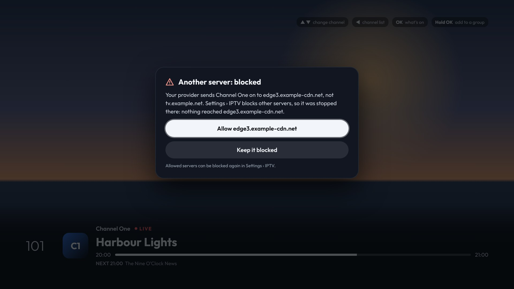

  - Every server the provider has tried shows under **What it connects to**, as **Blocked** or **Allowed**. OK switches it.
- **Off:** the launcher follows the provider to other servers, and Settings warns about it.

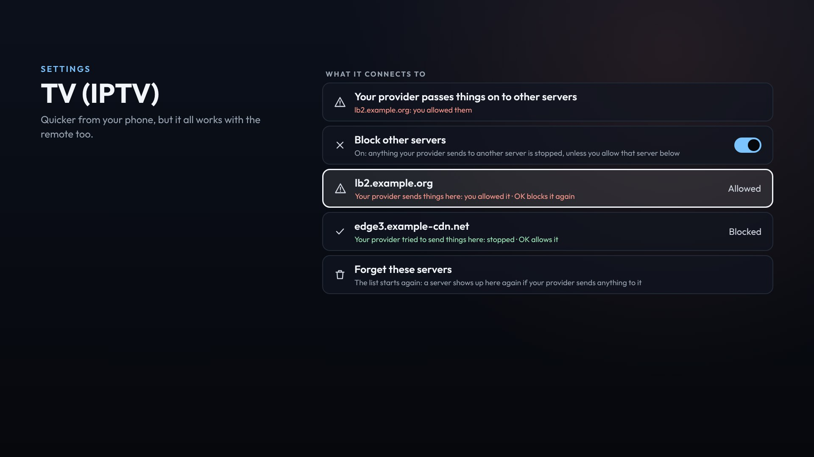

The warning shows whenever something goes to another server: one you allowed, or any while blocking is off. It names the server, and shows in three places:

- **Settings › TV (IPTV)**
- the TV line on the first Settings page
- the phone page

**Forget these servers** clears the list.

## Live TV

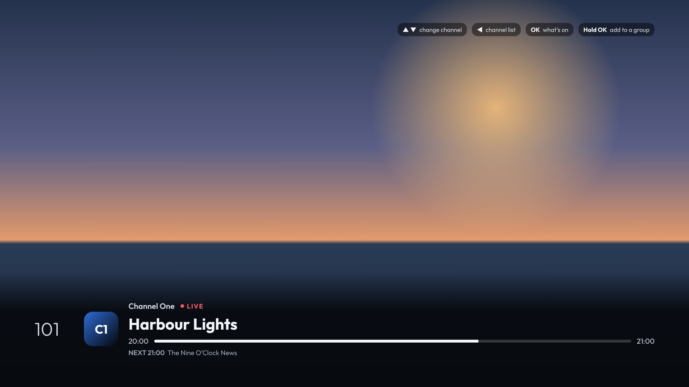

- **Rows:** **Recently watched**, then your groups, then (if **The provider's other groups** is on) the rest of the provider's.
- **Cards:** each channel card shows its logo, number and what's on now, with how far through it is.
- **The top:** the focused channel's programme: its time, how long is left, what it's about, and what's next. Nothing plays until you pick a channel.
- **Groups** (next to Search) jumps to any group.
- **OK** watches the channel.
- **Holding OK** puts the channel in one of your groups (see below).

### While watching

| Button | |
| --- | --- |
| **▲ ▼** | The previous or next channel in the row it was picked from (Channel + and − too). One press is one switch. |
| **◀** | The channel list (see below) |
| **OK** | What's on: the programme and what's next |
| **Hold OK** | Add the channel to a group |
| **Back** | Back to the TV tab |

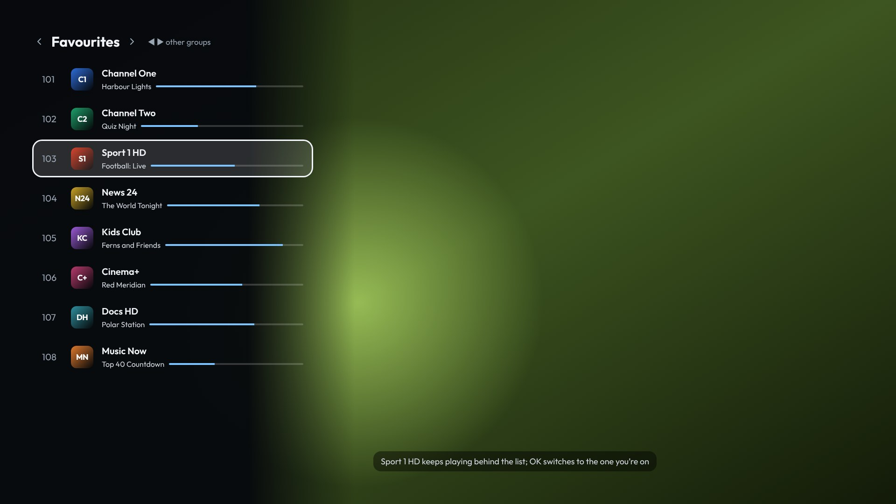

**The channel list** opens down the left, with the channel still playing behind it:

- **▲ ▼** go through the channels.
- **◀ ▶** switch to another group.
- **OK** switches to the channel you're on.
- **Back** closes the list.

**If the picture drops:**

- A stream that drops or stalls is opened again by itself. The info bar says **Reconnecting…** while it happens.
- On a shaky connection, make the buffer bigger: **Settings › TV (IPTV) › Buffer** (see below).

## Your groups

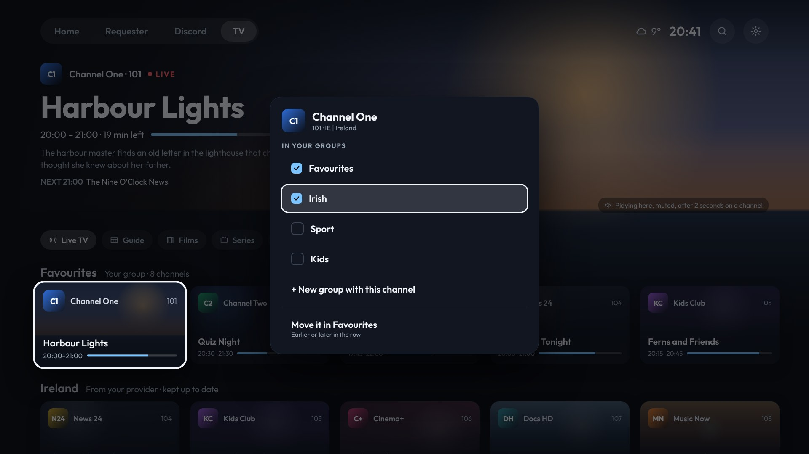

**Holding OK** on a channel (on the TV tab or while watching) shows your groups, ticked where the channel is in them:

- **OK** puts the channel in a group, or takes it out.
- **New group with this channel** makes a group with it in, after you type its name.
- **Move it in …** (holding OK on a channel in one of your groups) moves it with **◀ ▶**. **OK** drops it there.

**On your phone** groups are easiest:

- **Accounts › Your groups on the TV tab › + New group:** name it, search all the channels, tick the ones you want, and drag them into order.
- **✎** edits a group.
- Drag a group's handle to change the order of the rows. The switch shows or hides a group.

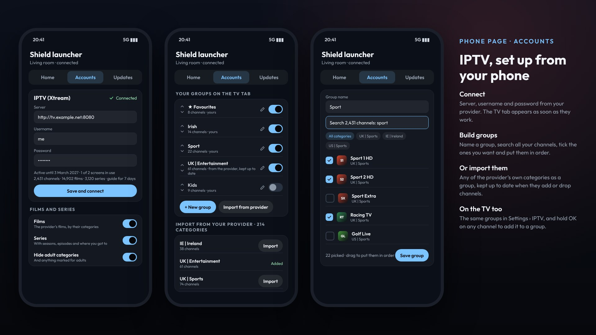

**Importing the provider's groups:**

- **Import from provider** (phone) or **Settings › TV (IPTV) › Import a group from your provider** (TV) puts one of the provider's groups on the TV tab.
- An imported group **follows the provider's**: channels they add or drop come and go by themselves.
- Changing an imported group's channels makes it yours, and it stops following theirs.

**In Settings › TV (IPTV)** on the TV:

- **OK** on a group shows or hides it.
- **Holding OK** moves, renames or deletes it.
- **The provider's other groups** turns off the provider's groups you haven't imported, so only your own show.

## Guide

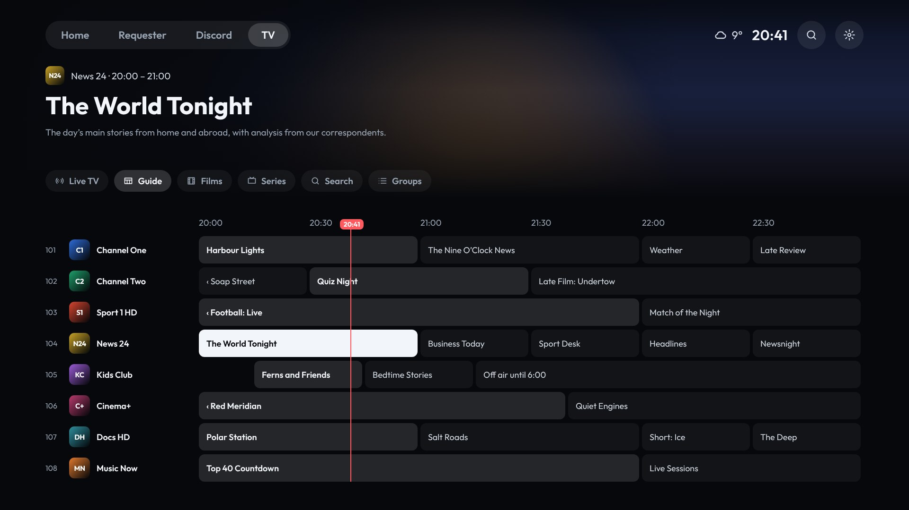

The guide shows every channel on the TV tab, by group, three hours across from now. The red line is the time now.

| Button | |
| --- | --- |
| **▲ ▼** | The channel above or below |
| **◀ ▶** | The previous or next programme on that channel, up to a day ahead |
| **OK** | Watch the channel |
| **Hold OK** | Add the channel to a group |

- **Groups** jumps to a group in the guide.
- A channel without a guide says so, and you can still watch it.
- Programmes that have finished aren't shown (no catch-up).

## Films

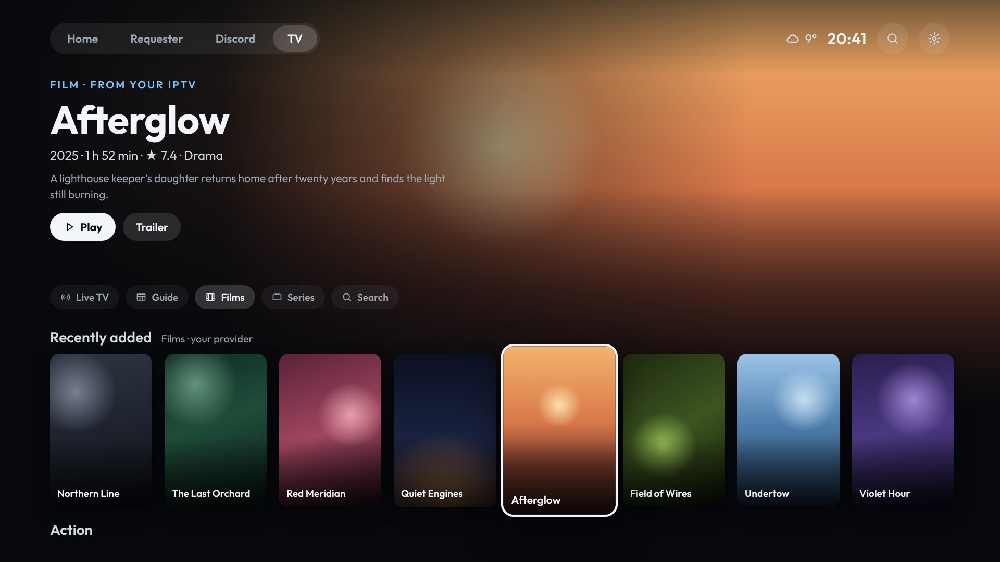

- **Rows:** **Continue watching** (films you started), **Recently added**, then the provider's film groups.
- **The top:** the focused film's year, length, rating, genre and story.
- **OK** plays it, from where you stopped if you started it.
- **Holding OK:**
  - **Play from the beginning**
  - **Trailer** (when the provider has one)
  - **Forget where you stopped**

## Series

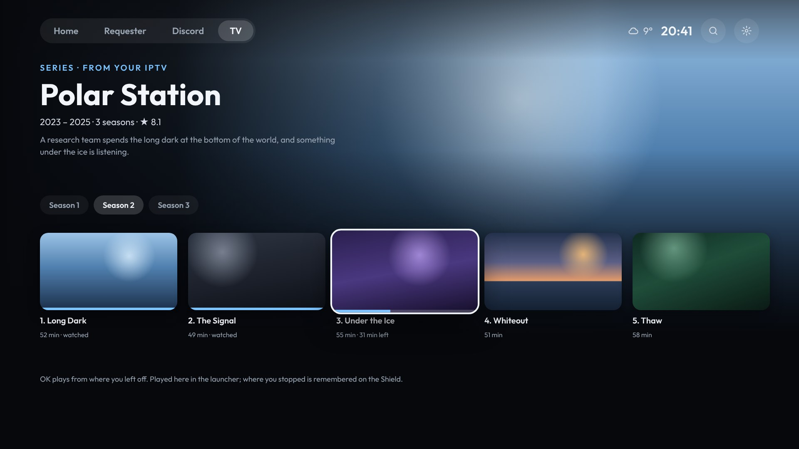

- **Rows:** **Continue watching** (the series you're in the middle of, on the episode you were on), **Recently updated**, then the provider's series groups.
- **OK** on a series opens it: its seasons along the top, and the season's episodes underneath. Each episode shows how long it is and how far you got.
- **OK** on an episode plays it from where you stopped. When it ends, the next one starts.
- **Holding OK** on an episode plays it from the beginning, or marks it as not watched.
- **Back** goes back to the series rows.

Where you stopped is kept on the Shield, for this account only. It isn't sent anywhere, and it's separate from Emby.

## Playing films and episodes

| Button | |
| --- | --- |
| **OK** | Pause or play |
| **◀ ▶** | 10 seconds back or forward. Hold it to go faster (30 seconds, then a minute at a time). |
| **▲ ▼** | Show where you are |
| **Back** | Stop. Where you stopped is kept. |

A film that drops is picked up again where it was.

## Search

**Search** (on the TV tab, or the magnifier at the top) looks for channels, films and series by name. The results are rows: channels, films, series. ▲ ▼ while watching a channel you found go through the other results.

## Settings › TV (IPTV)

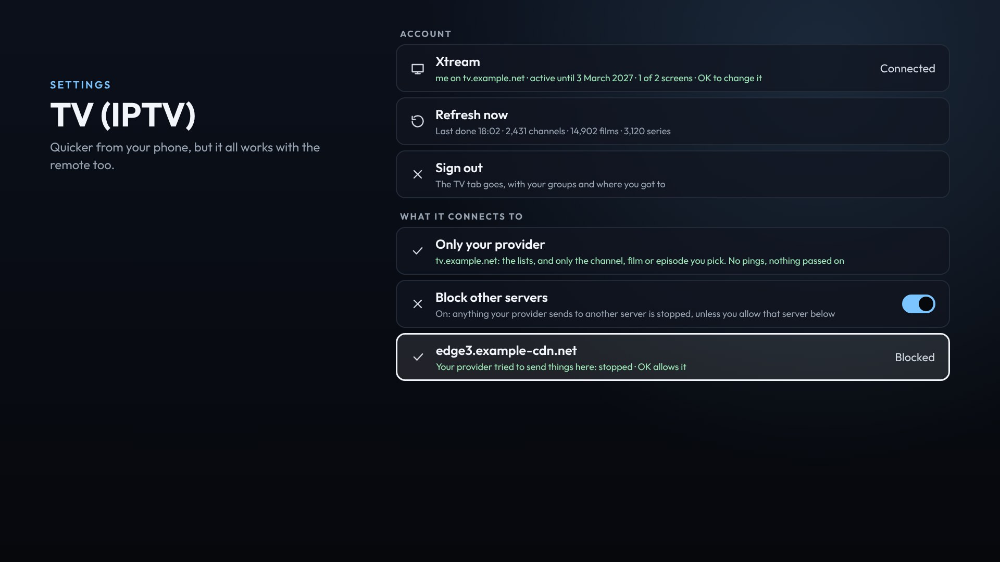

**Account**

- **Xtream:** who's connected, until when, and how many screens are in use. OK changes the account.
- **Refresh now:** fetches the channels, films and series again. Shows when they last came, and how many there are.
- **Sign out:** the TV tab goes, with your groups and where you got to.

**What it connects to**

- **Only your provider**, or a warning when something goes beyond it.
- **Block other servers**, and each other server the provider has tried. See [What it connects to](#what-it-connects-to).

**Groups on the TV tab**

- See [Your groups](#your-groups). This section also has **New group**, **Import a group from your provider** and **The provider's other groups**.

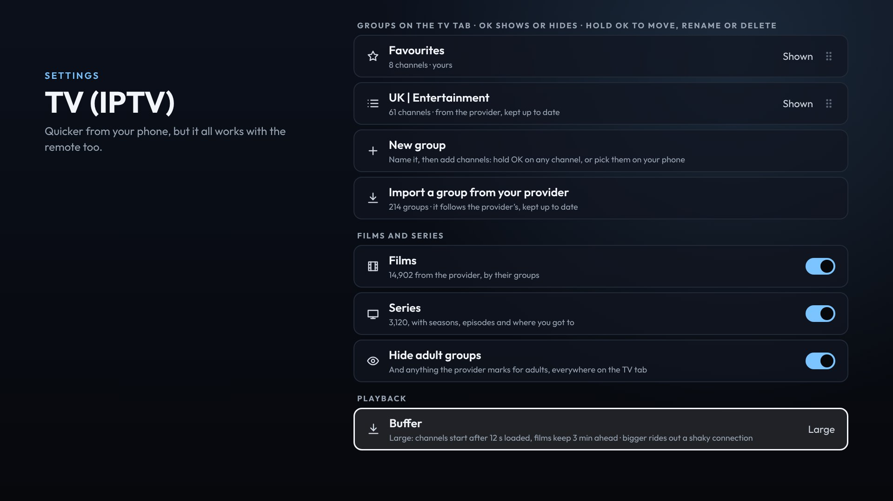

**Films and series**

- **Films** and **Series:** on or off. Off takes them off the TV tab.
- **Hide adult groups:** on to begin with. Adult groups, and anything the provider marks for adults, are left out everywhere.
- **Fetched again:** how often the films and series lists come again. **Refresh now** does it at once.

**Playback**

- **Buffer:** how much is loaded before playing:

  | Buffer | A channel starts after | Films and episodes read ahead |
  | --- | --- | --- |
  | Smallest | 1 second | 30 seconds |
  | Small | 3 seconds | 1 minute |
  | Medium (the default) | 6 seconds | 2 minutes |
  | Large | 12 seconds | 3 minutes |
  | Largest | 25 seconds | 5 minutes |

  A bigger buffer rides out a shaky connection: a channel keeps that much in hand, so a short drop doesn't stop the picture. The cost is that channels take that much longer to start. It applies from the next channel or film.

## If something's wrong

- **The TV tab is empty:** **Settings › TV (IPTV)** says what the provider answered. **Refresh channels and guide** tries again.
- **A channel won't play:** if it says **Another server: blocked**, allow the server (or turn off **Block other servers**). Otherwise, some providers allow only one screen at a time: close other apps that use the same account.
- **A channel stutters or keeps reconnecting:** try a bigger **Buffer**.
- **No guide for a channel:** the provider has none for it. Some providers have no guide at all.
