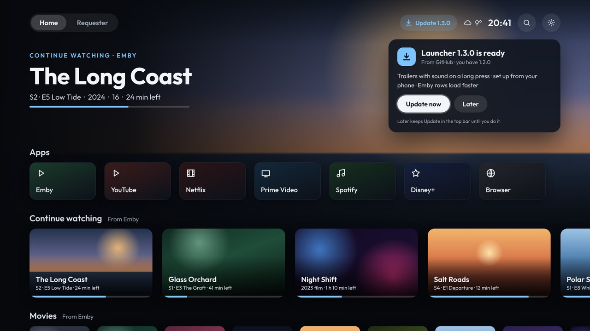
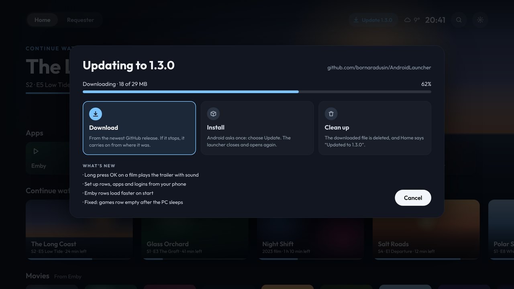

# Updates

The launcher looks for a new release on GitHub when the Shield starts, then every 6 hours.

1. **A note on Home** says a new version is ready, with what's new.
   - **Update now** starts it.
   - **Later** hides the note. An **Update** button stays in the top bar until you use it.
2. **It downloads.** If the download stops, it carries on from where it got to.
3. **Android asks once:** choose **Update**. The first time, Android may first ask you to allow the launcher to install apps.
4. **The launcher opens again on the new version.** It deletes the downloaded file, and Home says "Updated to …".

The phone page's **Updates** tab can look for a new version and start the update too. Android still asks on the TV.
