# Weather

The weather shows beside the clock on the apps row: now, and the next 5 days. It comes from [Open-Meteo](https://open-meteo.com), free and with no account.

## What each weather looks like

Behind the apps row, the colours come from the weather and the time of day: blue sky and gold for sun, indigo at night, steel blue in the rain, icy blue for snow, greys for cloud and fog, storm purple for thunder. The weather moves over the whole screen, and the forecast sits beside the clock.

| | |
|---|---|
| **Sunny**: a bright sun with slowly turning rays, the lens's flare across the screen, and dust drifting in the light | **Clear night**: the Milky Way, stars twinkling in white, blue and gold (the brightest glint), the moon in tonight's real phase, and shooting stars every few seconds |
| 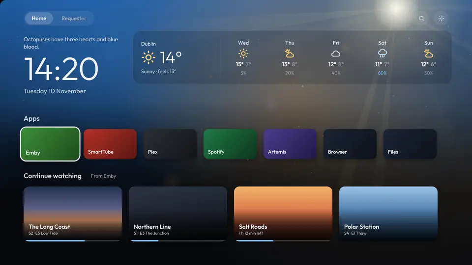 | 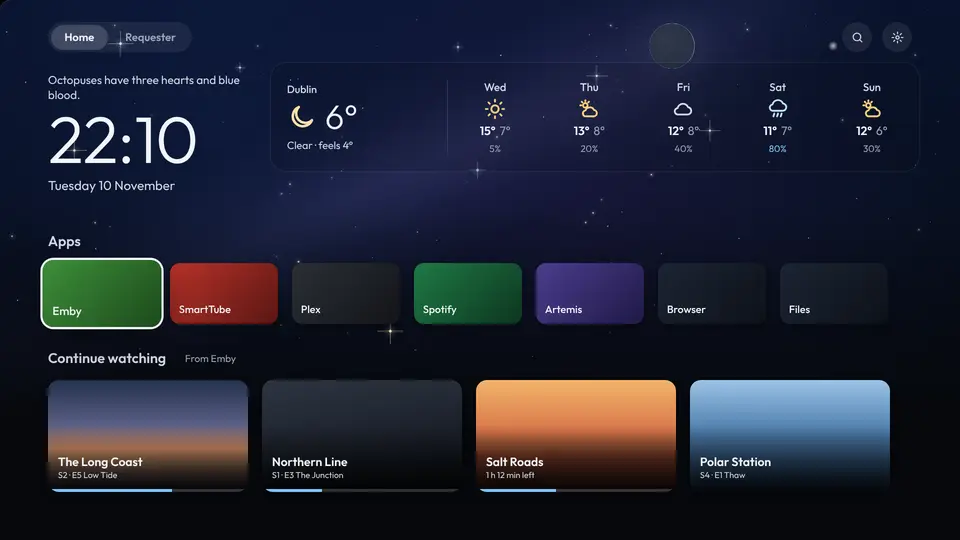 |
| **Partly cloudy**: the sun and its rays, with puffy clouds (lit on top, shaded underneath) drifting in two layers. A cloud over the sun dims its rays | **Partly cloudy at night**: the night sky with dark clouds drifting in front of it |
| 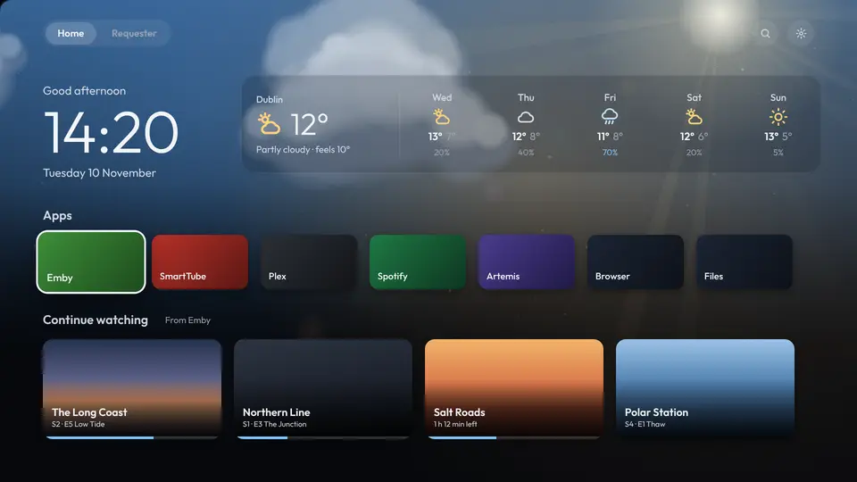 | 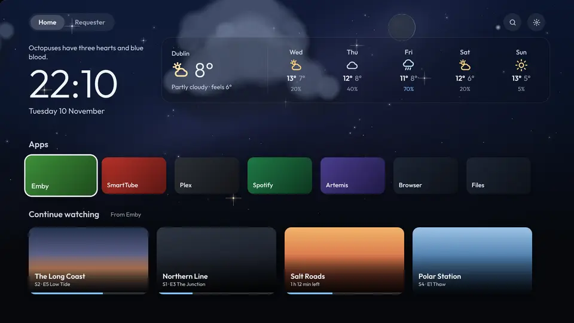 |
| **Cloudy**: a low grey sky full of clouds in three layers, near ones bigger and faster | **Fog**: haze over everything, banks of mist drifting both ways at different depths, and specks of damp in the air |
| 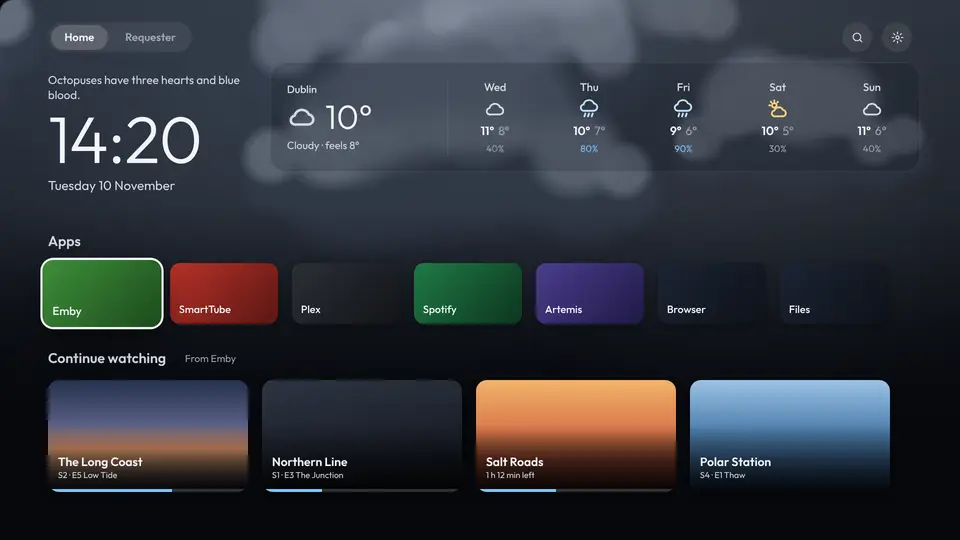 | 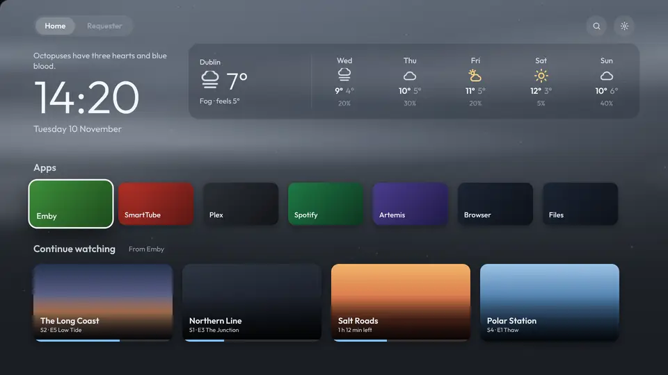 |
| **Rain**: storm clouds, rain at three depths with gusts changing its angle, and drops on the glass in front of everything: they show the world upside down like real drops, run down leaving beads behind, with a fine mist between them | **Snow**: snow near and far (big soft flakes close up), gusts sweeping it sideways, flakes glinting (and icicles and ice in the air when it's 0° or below) |
| 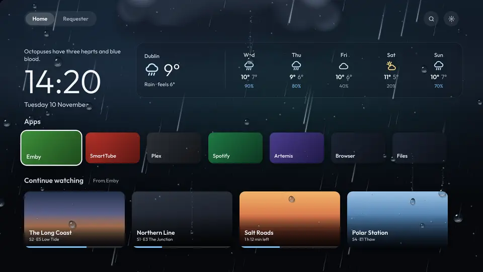 | 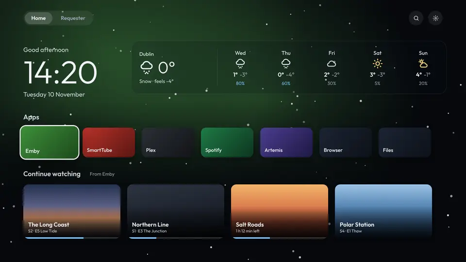 |
| **Thunder**: heavier rain, lightning flickering inside the clouds, and a forked bolt now and then. Here with a weather warning above the forecast | |
| 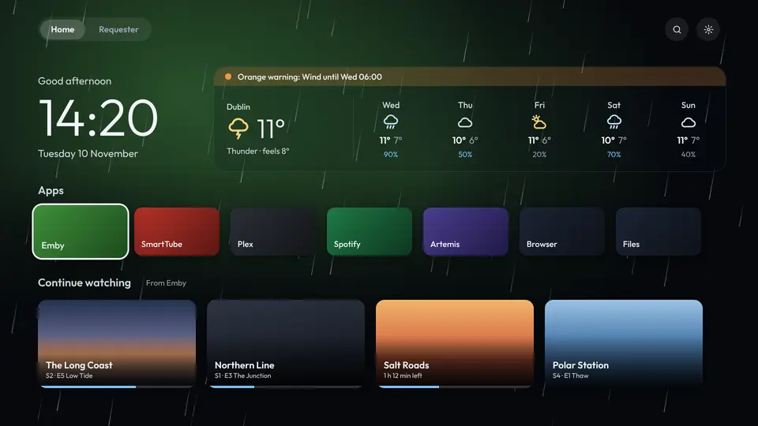 | |

## The moon

The moon is drawn as it really is that night, worked out from the date: a thin crescent lit on the right as it grows, half lit at first quarter, full, then lit on the left as it wanes. Its glow is brightest at full moon. It sits where it really is in your sky, and only shows while it's up. Meteor showers, eclipses, the northern lights and rainbows are in [Seasons and the sky](Seasons-and-sky).

## Sunrise and sunset

Day and night go by your town's sunrise and sunset, on the minute (from the forecast). For about half an hour around each, the sky has a look of its own, mixed with whatever the weather is: the sun low on the horizon (on the left at sunrise, the right at sunset, where it really is) with long rays fanning up across the sky, the sky going gold at sunrise and red and violet at sunset, and the stars fading out or coming out on the side away from the sun. Clouds and fog catch the colour; rain and snow let less of it through, and a thunderstorm only a hint.

| | |
|---|---|
| **Sunrise**, clear | **Sunset**, partly cloudy |
| 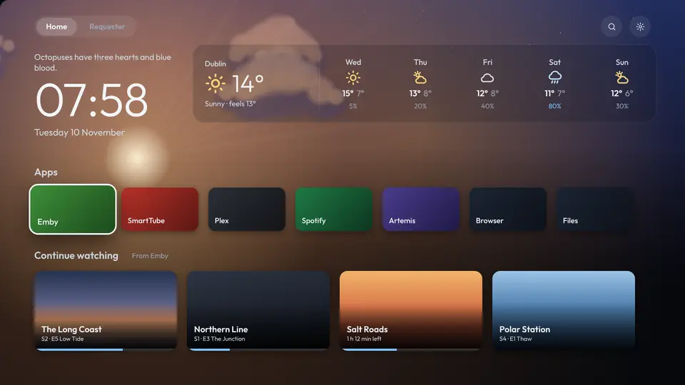 | 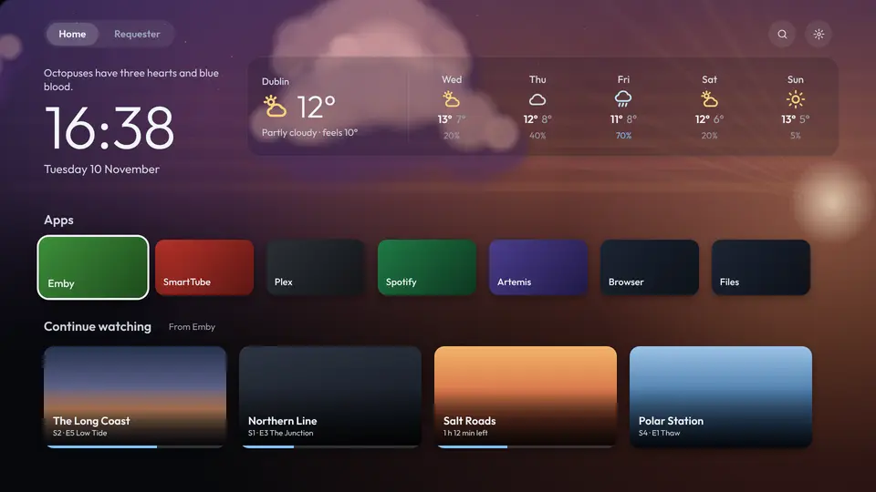 |
| **Sunset in the rain** | |
| 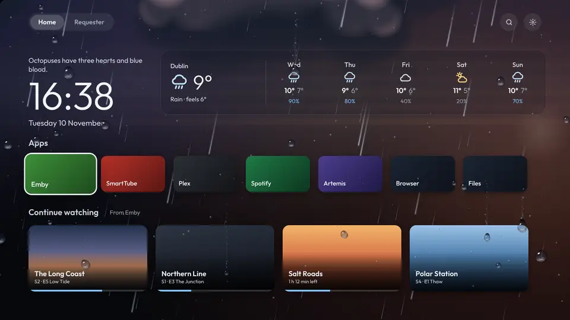 | |

The weather's movement only shows on the apps row. On a film, show or game the top of the screen has its picture (or trailer) instead.

## Your town

Out of the box, the weather is for where the Shield's internet connection is, which is usually the right town but not always. To set it:

1. Open **Set up from your phone** (Settings on the TV shows the code to scan).
2. On the **Home** tab, under **Weather**, type your town and press **Save**.

Leave the town empty to go back to the internet connection's location. Settings › Weather and notifications › **Weather for** on the TV shows which town it is.

## Weather warnings

Yellow, orange and red warnings (wind, storms, snow, ice, heat, floods and so on) come from [Meteoalarm](https://meteoalarm.org), where Europe's weather services publish them.

- **A new warning** shows over whatever is on, once: in the top right, for 15 seconds.
- **While it lasts**, a coloured line above the forecast says what it is and until when.
- **Settings › Weather and notifications › Weather warnings** turns the pop-ups off (the line above the forecast stays).

Warnings are matched to your town and its county or region. If yours don't show up, set **Warnings region** on the phone page to the name Meteoalarm uses for your area. The list offers the areas that have warnings just now.

Meteoalarm covers most European countries. Elsewhere there are no warnings, only the forecast.
